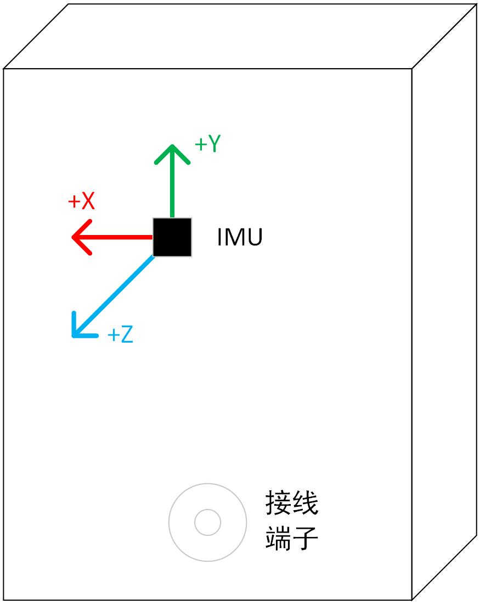

# zvlidar_ros_driver

#### 1. Prerequisites

(1) Install a ubuntu PC. We suggested Ubuntu 18.04 and ubuntu 20.04. Please do not use virtual machine.
(2) Install ROS/ROS2 full-desktop version. We tried Noetic and Humble.

####  2. Install

(1). Copy the whole zvision_ros_driver_vxx.zip and zvision_sdk_vxx.zip into ROS/ROS2 workspace, i.e "~/catkin_ws/src". Please make sure your dir name has no special characters, '+', '(', ')' etc.

* if you have no worksapce you need:

ROS1:
```
mkdir -p ~/catkin_ws/src
cd ~/catkin_ws/src
catkin_init_workspace
cp your_path/zvision_ros_driver_xxx.zip .
cp your_path/zvision_sdk_xxx.zip .
unzip zvision_ros_driver_xxx.zip
./init_ros.sh
./change_to_ros1.sh
```

ROS2:
```
mkdir -p ~/colcon_ws/src
cd ~/colcon_ws/src
cp your_path/zvision_ros_driver_xxx.zip .
cp your_path/zvision_sdk_xxx.zip .
unzip zvision_ros_driver_xxx.zip
./init_ros.sh
./change_to_ros2.sh
```

(2). Then to compile the source code and to install it:

ROS1:
```
cd ~/catkin_ws
catkin_make
```

ROS2:
```
cd ~/colcon_ws
colcon build
```

#### 3. Configure PC IP

By default, the ZVISION_LIDAR is configured to **192.168.10.108** as its device IP and **192.168.10.255** as destination IP that it would communicate. The default **LiDAR UDP dst port is 2368**.
So you need configure your PC IP as a static one **192.168.10.10**.

#### 4. Run online lidar or paly offline pcap file

We have provide example run.launch for ROS and run.py for ROS2 under zvlidar_sdk/launch, config.yaml file under zvlidar_sdk/config, you can run the launch or python file to view the point cloud data. For example, if you want to view lidar or pcap pointcloud data:
(1). Open a new terminal and run:

ROS1
```
cd ~/catkin_ws
source devel/setup.bash
roslaunch zvlidar_sdk run.launch
```

ROS2:
```
cd ~/colcon_ws
source install/setup.sh
ros2 launch zvlidar_sdk run.py
```

Then we can view the pointcloud via "rviz" or rviz2

#### 5. About the lidar calibration parameters

under zvision_sdk/doc, you can find the angle compensation file for lidars

#### 6. Config Parameters

We can configure the playback parameters of one or more lidar devices in config.yaml in zvlidar_sdk/config, the support parameters as follow:

For single online lidar, we have three parts of parameters setting.

> - base
>
>   The basic playing parameters that lidar ip, port or pcap file path ...
>
> - ros
>
>   We can configure the topic prefix name and whether to publish one or more topics.
>

| Param                  | Definition                         | Ranges                                                       | Notes                                                        |
| ---------------------- | ---------------------------------- | ------------------------------------------------------------ | ------------------------------------------------------------ |
| lidar_type             | Type of LiDAR                      | ML30S/ ML30SFactory/ ML30SPlus/ ML30SPlusB1_40/ML30SPlusB1_90/MLXS | "Player type was not matched with pointcloud type" will be printed in the console if this parameter is set incorrectly. |
| lidar_ip               | IP of LiDAR                        | ---                                                          | If this value does not match the device, there will be no pointcloud message and will get "No frames found for lidar ip:port" message in the console. |
| lidar_port             | UDP dst port of LiDAR              | ---                                                          | If this value does not match the device, there will be no pointcloud message and will get "No frames found for lidar ip:port" message in the console. |
| online                 | Play mode                          | true / false                                                 | true: play online lidar<br/>false: play pcap file            |
| multicast_en           | Join Multicast                     | true / false                                                 | Enable to join multicast.                                    |
| multicast_ip           | Ip Address                         | Valid ip address                                             | Multicast ip address.                                        |
| pcap_path              | Offline pcap file path             | ---                                                          | If the program fails to open the file, it will print "OfflinePointCloudProducer GetPointCloudInfo failed" in the console. |
| angle_path             | Path of calibration file           | ---                                                          | If the driver fails to open the file,it will print "OfflinePointCloudProducer GetPointCloudInfo failed" in the console.<br />if the value is set to "", the driver will get calibration data online (only works in online mode). |
| pcap_rate              | Frame rate                         | default:10                                                   | Frame rate for play of offline pcap point cloud data. Unit:hz. |
| frame_id               | Frame id                           | ---                                                          | Manu set Frame id.                                           |
| topic_tag_name         | Topic prefix string                | ---                                                          | If topic_tag_name is zvlidar_ml30s,if pub_pointcloud_xyzi is true, the topic name is zvlidar_ml30s_points_xyzi ... |
| use_lidar_time         | Source of message header timestamp | true / false                                                 | True: use lidar timestamp from first udp packet data.  False: use system timestamp from first udp packet that captured. |
| use_lidar_line_id      | Publish lines info                 | true / false                                                 | For PointCloudXYZIRT, if true R:point line id, else R:fov id. |
| pub_lidar_packet       | Publish packets sw                 | true / false                                                 | Publish lidar frame raw data or not. not support now         |
| pub_pointcloud_xyzi    | PointCloudXYZI                     | true / false                                                 | Publish lidar PointCloudXYZI message or not.                 |
| pub_pointcloud_xyzirt  | PointCloudXYZIRT                   | true / false                                                 | Publish lidar PointCloudXYZIRT message or not.               |
| pub_pointcloud_xyzrgba | PointCloudXYZRGBA                  | true / false                                                 | Publish lidar PointCloudXYZRGBA message or not.              |
| pub_imu_msg			 | imu msg			                  | true / false                                                 | Publish lidar imu message or not.              				|

#### 6.1 Data source: `transport` (udp / serial)

The driver supports two data sources selected by the `transport` field: `udp` (network, EZ6_B2/NZ1_A2) or `serial` (dual-uart, MRZ16 EE-FF).

| Param        | Definition                 | Ranges                  | Notes                                                                  |
| ------------ | -------------------------- | ----------------------- | ---------------------------------------------------------------------- |
| transport    | Data source type           | udp / serial            | udp: network (EZ6_B2/NZ1_A2); serial: dual-uart (MRZ16 EE-FF)          |
| lidar_type   | Type of LiDAR             | ez6_b2 / nz1_a2 / mrz16 | must match the physical device                                         |
| port_send    | Serial command port        | device path / COMx      | only for transport: serial (e.g. /dev/ttyACM2, COM3)                   |
| port_recv    | Serial pointcloud port     | device path / COMx      | only for transport: serial (e.g. /dev/ttyACM0, COM4)                   |
| baud_send    | Baud rate of command port  | e.g. 9600               | only for transport: serial                                             |
| baud_recv    | Baud rate of pointcloud port | e.g. 3125000          | only for transport: serial                                             |

#### 6.2 Config files

- `config/config.yaml` — **default** config (udp template) loaded by `run.launch` (ROS1) / `run.py` (ROS2).
- `config/config_udp_demo.yaml` — example for a single udp lidar.
- `config/config_serial_demo.yaml` — example for a single serial (MRZ16) lidar. To run a serial lidar, copy its content into `config.yaml` or launch with `yaml_path` pointing to it.
- `config/multi_config_demo.yaml` — example for multiple lidars (udp + serial mixed).

To run multiple lidars, copy `multi_config_demo.yaml` content into `config.yaml` (or add extra `- base:` entries under the `lidar:` list).

#### 7. IMU information
The IMU coordinate system is as shown in the figure below, with the LiDAR optical center located at coordinates (-2.60395, -19.3056, -55.27) in the IMU coordinate system.

